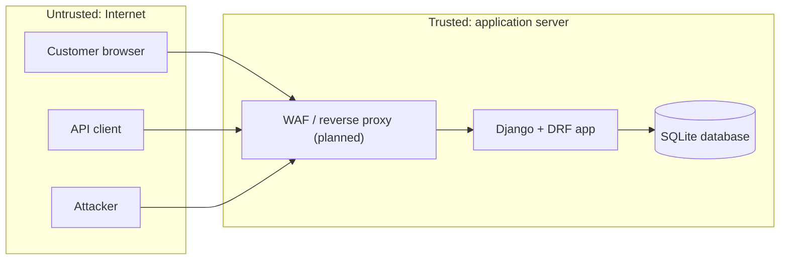

# TechMarket: Architecture and Threat Model

Author: Student 3 (Offensive Validation & Runtime Security)

## 1. About the project

TechMarket is an online phone store built with Django and Django REST Framework. It has three entry points:

| Entry point | What it does | Who uses it |
|---|---|---|
| Storefront (`/`) | Browse catalog, register, log in, cart, checkout, lucky-wheel coupon | Customers (session login) |
| REST API (`/api/`) | Log in for a token, create, read, change and delete own orders | API clients (token login) |
| Admin (`/admin/`) | Manage products and orders | Staff |

Data lives in a SQLite database: users, brands, categories, phones (price, stock), orders and customer profiles (coupons).

## 2. Architecture

**Trust boundaries**

- **TB1: Internet to server.** Everything coming in (forms, URL parameters, JSON, headers, cookies) is untrusted.
- **TB2: Application to database.** Only the application should reach the database.

**Authentication**

- Storefront: Django session cookie.
- API: DRF token in the `Authorization` header.

## 3. What we protect

| ID | Asset | Why it matters |
|---|---|---|
| A1 | User accounts, sessions, API tokens | Account takeover |
| A2 | Customer data and order history | Privacy |
| A3 | Orders, stock, promo codes | Money loss |
| A4 | Admin panel | Full control of the store |
| A5 | `SECRET_KEY` and other secrets | Forging sessions and signed data |
| A6 | Availability of the site | Sales, reputation |
| A7 | Source code, dependencies and the CI/CD pipeline | A compromised pipeline or dependency ships attacker code to every user |

## 4. Who can attack

- Anonymous visitor.
- Registered customer who abuses their own account (most important for this shop).
- Another website that tricks a customer's browser.
- Automated bots and scanners.

## 5. Threats

Method: manual review of `settings.py`, `urls.py`, `shop/views.py`, `shop/models.py`, `shop/serializers.py`, `shop/api_urls.py`, `shop/urls.py` and STRIDE.

**Risk = Likelihood (1 to 3) x Impact (1 to 3).** 1 to 3 Low, 4 to 6 Medium, 9 High.
**Status:** "Open" means the problem exists in the current code. "Fix proposed" means a change is in `patches/code-fixes.patch` or the hardened `settings.py`, but it is not merged yet. "Fixed (PR #n)" means the fix is merged into `main` and checked by the CI security pipeline.

| ID | STRIDE | Threat and how the attack works | Asset | L | I | Risk | Fix | Status |
|---|---|---|---|---|---|---|---|---|
| T1 | Tampering | **Customer sets their own order status.** `status` is writable in `OrderSerializer`; `POST`/`PUT /api/orders/` with `"status": "delivered"` works | A3 | 3 | 3 | 9 High | Make `status` read-only; allow edits only for `pending` orders | Fixed (PR #3) |
| T2 | Tampering | **Bad order data through the API.** Quantity 0 or a huge number, products that are out of stock, product changed after the order was placed | A3 | 3 | 2 | 6 Medium | Validate quantity (1 to 10) and stock; product cannot change | Fixed (PR #3) |
| T3 | Tampering | **Overselling and half-finished orders.** Checkout creates orders item by item without a transaction and updates stock in Python, so parallel requests or an error in the middle break stock and orders | A3 | 2 | 3 | 6 Medium | `transaction.atomic`, row lock, `F()` updates, recheck stock | Fix proposed |
| T4 | Tampering / DoS | **Invalid input crashes pages.** Negative cart quantity (`-5`) gives negative totals and an error at checkout; non-numeric `quantity`, `category`, `min_price` return HTTP 500 | A3, A6 | 3 | 2 | 6 Medium | Parse and clamp all numeric input | Fix proposed |
| T5 | Info disclosure / Spoofing | **Insecure core settings.** `DEBUG=True` shows stack traces and settings; `SECRET_KEY` is hardcoded in the repository (anyone with the code can forge sessions); `ALLOWED_HOSTS` is empty | A1, A5 | 3 | 3 | 9 High | Read from environment variables; rotate the old key | Fixed (PR #5): settings from environment, app refuses to start without a key, old key rotated; custom gitleaks rule blocks new hardcoded keys |
| T6 | Spoofing | **Open redirect.** After login and add-to-cart the `next` parameter is used without checking, so `?next=https://evil.example` sends users to a fake site (phishing) | A1 | 3 | 2 | 6 Medium | Allow only same-host redirects | Fix proposed |
| T7 | Spoofing | **Password guessing.** No attempt limit on the web login or the API login | A1 | 3 | 2 | 6 Medium | 5/min limit on API login (proposed); rate limit at WAF; consider account lockout for web login | Partly proposed |
| T8 | Spoofing | **Stolen token works forever.** API tokens never expire, are the same for every login and are stored in plaintext | A1 | 2 | 3 | 6 Medium | 24 h expiry, new token on each login | Fixed (PR #2): JWT, access 15 min, refresh 1 day; old tokens rejected (CI test) |
| T9 | Info disclosure | **Cookies and tokens sent over plain HTTP.** No HTTPS redirect, HSTS or Secure cookie flags | A1 | 2 | 3 | 6 Medium | Enable the HTTPS settings; TLS at the edge | Fixed in settings (PR #5): HTTPS redirect, HSTS, Secure cookies when `DEBUG` is off, checked by `manage.py check --deploy` in CI; TLS at the edge at endterm |
| T10 | Elevation | **Admin panel guessable and public** at `/admin/` | A4 | 2 | 3 | 6 Medium | Restrict by IP or VPN at the WAF; strong staff passwords | Planned |
| T11 | DoS | **Request floods.** No throttling on the API or search | A6 | 3 | 2 | 6 Medium | DRF throttling now; WAF rate limits later | Fix proposed |
| T12 | Tampering | **CORS allows every origin with credentials.** Real impact is limited because Django's default `SameSite=Lax` cookie is not sent on cross-site `fetch`, but the setting is unsafe and breaks if cookie settings change | A2 | 2 | 2 | 4 Medium | Origin allowlist | Fixed (PR #5): `CORS_ALLOWED_ORIGINS` allowlist; custom Semgrep rule blocks `CORS_ALLOW_ALL_ORIGINS = True` |
| T13 | Tampering | **Promo and totals are not enforced.** Delivery fee and discount are only shown, never saved on the order; a coupon is never used up, so it can be reused | A3 | 2 | 2 | 4 Medium | Store price, total and applied promo on `Order`; invalidate coupon after use | Open (needs model change) |
| T14 | Repudiation | **Customers can delete shipped orders** through the API, and there is no audit log of order or admin changes | A3 | 2 | 2 | 4 Medium | Delete only `pending` orders; add audit logging | Fix proposed (delete); logging planned |
| T15 | Tampering | **Other gaps.** API orders do not reduce stock (web checkout does); logout works on GET; `dismiss_lucky_wheel` has no login check; coupon codes use non-secure `random` | A3 | 1 | 2 | 2 Low | Align API and web, POST-only logout, `SystemRandom` | Partly proposed |

### 5.1 Development and delivery process (CI/CD and supply chain)

Method: review of the GitHub repository, the developer setup and the GitHub Actions workflow with STRIDE (lecture 1: developer environments and dependencies are part of the attack surface).

| ID | STRIDE | Threat and how the attack works | Asset | L | I | Risk | Fix | Status |
|---|---|---|---|---|---|---|---|---|
| T16 | Spoofing | **Stolen developer account pushes code.** A phished GitHub password is used to push straight to `main` | A7 | 2 | 3 | 6 Medium | 2FA for every member; ruleset `protect-main`: pull request, 1 code-owner approval, required `security-gate`, no force push | Fixed (PR #5, repository settings) |
| T17 | Tampering | **Vulnerable or malicious dependency.** A known-vulnerable version stays pinned, or a typo-squatted package is added | A7, A1 | 3 | 3 | 9 High | Exact version pins; pip-audit gate in CI (78 known vulnerabilities removed by upgrading Django 4.2 to 5.2 LTS); Dependabot weekly PRs; dependency review on PRs | Fixed (PR #5) |
| T18 | Elevation | **A gate is switched off quietly.** A developer edits the workflow or scanner config to skip a check | A7 | 2 | 3 | 6 Medium | CODEOWNERS: two owners on `.github/`, scanner configs and `requirements.txt`; ruleset without bypass | Fixed (PR #5) |
| T19 | Info disclosure | **Secret committed or printed in CI logs** | A5 | 3 | 3 | 9 High | gitleaks with custom Django and Keycloak rules in pre-commit and CI (full history); GitHub push protection; CI secret stored as a masked Actions secret | Fixed (PR #5) |
| T20 | Tampering | **Insecure code merged.** IDOR, raw SQL, `DEBUG = True` or an open CORS policy reaches `main` | A2, A3 | 3 | 2 | 6 Medium | Pre-commit hooks; Bandit and Semgrep (community + 10 custom rules) as a required gate; 15 security regression tests | Fixed (PR #5) |
| T21 | Repudiation | **Unclear who changed or approved what** | A7 | 2 | 2 | 4 Medium | Changes only through pull requests with review; squash commits; PR history is the audit trail | Fixed (PR #5) |

**Not reviewed (files were not available):** `shop/forms.py`, templates, `shop/admin.py`, static JavaScript. These may hide cross-site scripting, unsafe profile fields or user enumeration at registration.

## 6. What is already safe

| Area | Why |
|---|---|
| SQL injection | All queries use the Django ORM; no raw SQL in the reviewed files |
| Reading other users' orders | Web and API both filter orders by the logged-in user |
| Price tampering | Price is always read from the database, never from the request |
| CSRF | `CsrfViewMiddleware` is on and protects POST requests |
| Passwords | Hashed by Django, validators enabled |

## 7. Priorities

Fix first: **T1, T5**, then T3, T4, T6, T7, T8.

## 8. How the findings will be confirmed

Findings come from reading the code. They are not yet confirmed by running the application, and the proposed fixes have not been run yet. Planned manual tests:

| Test | Confirms |
|---|---|
| `POST /api/orders/` with `"status": "delivered"` | T1 |
| Order quantity 0, 100000, or an out-of-stock product | T2 |
| Two parallel checkouts for the last item in stock | T3 |
| `quantity=-5`, `quantity=abc`, `min_price=abc` | T4 |
| Login with `?next=https://evil.example` | T6 |
| 20 wrong passwords in one minute | T7 |
| Use an old token after logging in again | T8 |

## 9. Next steps (endterm)

WAF in front of the app, DAST and fuzzing, container isolation, runtime monitoring and logging. Design notes and starter files are in `Dockerfile` and `docker-compose.yml`.
